<div align="center">

# Enterprise360 · Retail & E-Commerce BI Platform

**An end-to-end analytics engineering project. Real public retail data goes from raw CSVs to a tested dbt star schema on PostgreSQL, and then into an 11-page Power BI report built for executives, sales, CRM, operations and data quality.**

[](https://github.com/nishanttyagi28/enterprise360/actions/workflows/ci.yml)


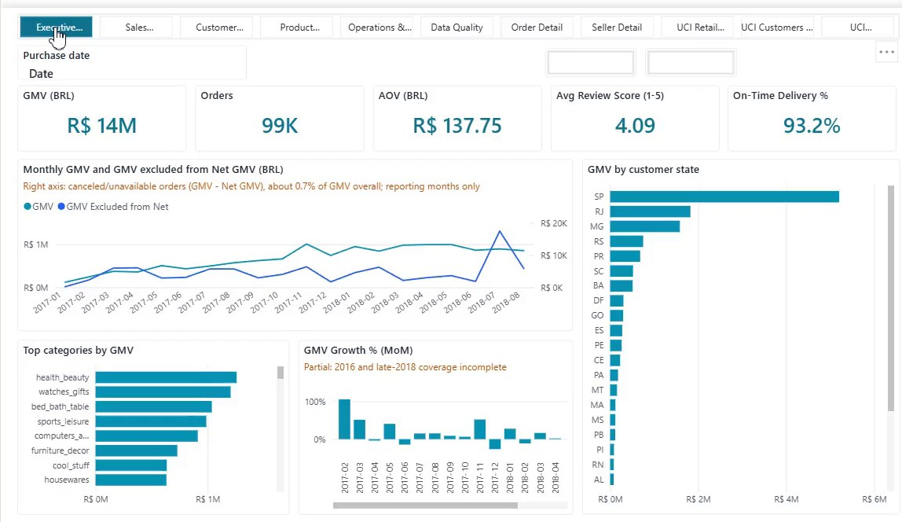

<sub><i>Executive Command Center: GMV, orders, AOV, review score and on-time delivery for the Olist marketplace (BRL).</i></sub>

</div>

---

## Table of Contents
- [Business Problem](#-business-problem)
- [Key Results at a Glance](#-key-results-at-a-glance)
- [Architecture](#-architecture)
- [Tech Stack](#-tech-stack)
- [Data Sources](#-data-sources)
- [Data Model](#-data-model)
- [Dashboard Gallery](#-dashboard-gallery)
- [KPI Definitions](#-kpi-definitions)
- [Data Quality & Testing](#-data-quality--testing)
- [Project Structure](#-project-structure)
- [Run It Locally](#-run-it-locally)
- [Continuous Integration](#-continuous-integration)
- [Design Decisions](#-design-decisions)
- [Roadmap](#-roadmap)
- [Author](#-author)
- [Licence & Data Attribution](#-licence--data-attribution)

---

## 🎯 Business Problem

A multi-channel retailer needs **one trusted view of the business**. Different departments report different numbers for "sales", and nobody can say how fresh or complete the data is.

Enterprise360 answers that with a governed BI stack:

| Stakeholder | Question answered | Report page |
|---|---|---|
| Leadership | How are GMV, orders, AOV, customer satisfaction and delivery trending? | Executive Command Center |
| Sales | Which categories, states, sellers and payment types drive GMV? | Sales Performance, Seller Detail |
| CRM | How many customers are new or repeat, and how do cohorts retain? | Customer Intelligence |
| Category management | Which products and categories sell, and how are they reviewed? | Product Performance |
| Operations | Are orders delivered on time? Where are the late orders? | Operations & Delivery, Order Detail |
| Data platform | Can these numbers be trusted today? | Data Quality |
| UK retail (2nd domain) | Net sales, retention, cancellations and discounts for a UK online retailer | UCI Retail pages |

**Objectives**
1. Ingest real public data **losslessly and idempotently**, with full audit and lineage.
2. Model it as a **Kimball star schema** with explicit grains and no fan-out.
3. Govern every metric through a **versioned KPI dictionary** that maps each KPI to its dbt column and its Power BI measure.
4. Ship the dashboards as **source-controlled Power BI (PBIP/PBIR + TMDL)**, validated in CI.

---

## 📊 Key Results at a Glance

All numbers come from the full public datasets, as built and verified locally.

| Metric (Olist, BRL) | Value |
|---|---|
| Gross Merchandise Value (GMV, freight excluded) | **R$ 14M** |
| Orders | **99K** (`core.fct_orders` = 99,441 rows) |
| Average Order Value | **R$ 137.75** |
| Average review score (1–5) | **4.09** |
| On-time delivery rate | **93.2%** |

| Pipeline health | Value |
|---|---|
| `dbt build` | **PASS = 288, WARN = 5, ERROR = 0** |
| `pytest` | **75 / 75 passing** |
| `ruff` and `mypy --strict` | **clean** |
| UCI invoice lines (`uci_core.uci_fct_invoice_lines`) | **1,033,036 rows** (source files: 1,067,371 rows before staging de-duplication) |

> **Note:** GMV is **not** recognised revenue. It is the sum of item prices, with freight excluded. The model and the report never label it as revenue.

---

## 🏗 Architecture

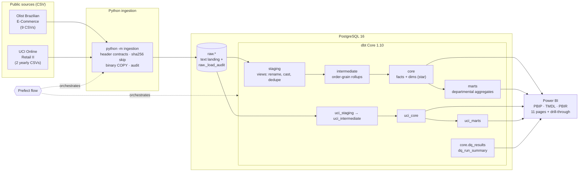

| Layer | Owner | Materialisation | Why |
|---|---|---|---|
| `raw` | Python | tables, every column `text` | Lossless landing. A malformed value never fails a load; typing happens once, in dbt |
| `staging` | dbt | views | Thin and always current: rename (fixes the `lenght` typos), cast, null-normalise, dedupe |
| `intermediate` | dbt | views (zip centroid: table) | Explicit grains. Geolocation (1M rows) is aggregated once |
| `core` | dbt | tables; `fct_order_items` and `fct_payments` are incremental | Fast BI import. The star schema Power BI reads |
| `marts` | dbt | tables | Small, BI-ready, with ratios stored as numerator and denominator |
| `uci_*` | dbt | same pattern | An independent UK domain, **never joined to Olist** |

---

## 🧰 Tech Stack

| Area | Tools |
|---|---|
| Ingestion | Python 3.12, psycopg (binary `COPY`), tenacity (retries), structlog (JSON logs) |
| Warehouse | PostgreSQL 16 (native Windows service; optional `docker-compose.yml`) |
| Transformation | dbt Core 1.10 + dbt-postgres, dbt_utils, seeds, an SCD2 snapshot, `on-run-end` DQ hooks |
| Orchestration | Prefect (`python -m orchestration.flow`) |
| BI | Power BI Desktop, PBIP project format, TMDL semantic model, PBIR report, custom light theme (WCAG AA) |
| Governance | YAML KPI dictionary → generated [KPI catalog](docs/kpi-catalog.md) |
| Quality | pytest (unit + integration), ruff, mypy `--strict`, dbt tests, PBIP validator |
| DevOps | GitHub Actions, PowerShell scripts (Windows), Makefile (Linux/macOS) |

---

## 📦 Data Sources

The project uses **real public data only**. Nothing is synthesised for the report. Small synthetic fixtures exist only under `tests/fixtures/` for CI.

| Dataset | Domain | Period | Licence | Link |
|---|---|---|---|---|
| Olist Brazilian E-Commerce | Brazilian marketplace, BRL | 2016-09 → 2018-10 | [CC BY-NC-SA 4.0](https://creativecommons.org/licenses/by-nc-sa/4.0/) (non-commercial) | [Kaggle](https://www.kaggle.com/datasets/olistbr/brazilian-ecommerce) |
| Olist Marketing Funnel | Seller acquisition leads → closed deals | MQLs 2017-06 → 2018-05, deals won 2017-12 → 2018-11 | [CC BY-NC-SA 4.0](https://creativecommons.org/licenses/by-nc-sa/4.0/) (non-commercial) | [Kaggle](https://www.kaggle.com/datasets/olistbr/marketing-funnel-olist) |
| UCI Online Retail II | UK online retailer, GBP | 2009-12 → 2011-12 | [CC BY 4.0](https://creativecommons.org/licenses/by/4.0/) | [UCI ML Repository](https://archive.ics.uci.edu/dataset/502/online+retail+ii) |

Provenance, checksums and row-count cross-checks are in [`data/README.md`](data/README.md). The raw files themselves are not committed.

---

## 🧩 Data Model

Core Olist star schema (`core` schema). Surrogate keys are `dbt_utils.generate_surrogate_key` hashes of business keys, so they stay stable across rebuilds.

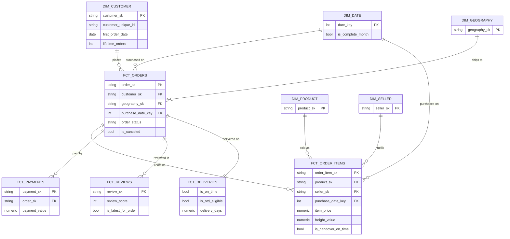

| Model | Grain |
|---|---|
| `fct_orders` | one order |
| `fct_order_items` | one order line `(order_id, order_item_id)`; 1 line = 1 unit |
| `fct_payments` | `(order_id, payment_sequential)` |
| `fct_reviews` | `(review_id, order_id)`; `review_id` alone is not unique |
| `fct_deliveries` | one order (delivery view) |
| `dim_customer` | `customer_unique_id`, the person (Olist issues a new `customer_id` for every order) |

**Marts:** `mart_sales_daily`, `mart_sales_by_seller_monthly`, `mart_sales_by_category_monthly`, `mart_business_overview_monthly`, `mart_customer_cohorts`, `mart_operations_delivery_performance`.
**Marketing Funnel** (`core` / `marts`): `dim_lead_origin` (channel; unknown member `not_recorded`), `fct_leads` (one MQL; 1:1 deal outcome, `days_to_close`), `fct_closed_deals` (one deal; `seller_sk` only when the seller exists in `dim_seller`: 380 of 842), `mart_funnel_monthly` (first-contact month × origin cohort; `conversion_rate = converted_leads_in_cohort / mqls`, `is_cohort_mature` at 210 days), `mart_funnel_time_to_close` (days bucket × origin). `declared_monthly_revenue_brl` is self-declared by the seller and is descriptive only.
**Forecast** (`marts`): `mart_gmv_forecast` (month), `mart_gmv_anomalies` (month), `mart_gmv_forecast_backtest`, written by `python -m analytics.forecast`. Method and limits: [docs/forecasting.md](docs/forecasting.md).
**MIS export:** `python -m reporting.export_mis` → `reports/enterprise360_mis_YYYYMMDD.xlsx` (one sheet per key mart + README sheet).
**UCI:** `uci_fct_invoice_lines` (signed line grain; cancellations are negative lines), `uci_fct_invoices`, plus product, customer, country and date dimensions.

---

## 🖼 Dashboard Gallery

<table>
<tr>
<td width="50%"><b>Sales Performance</b><br>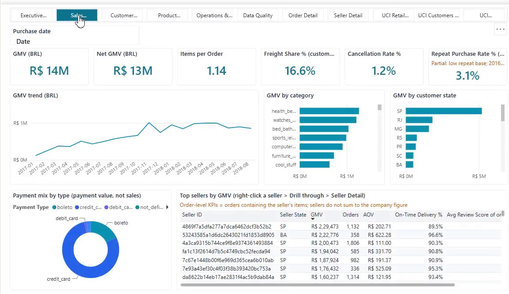</td>
<td width="50%"><b>Customer Intelligence</b><br>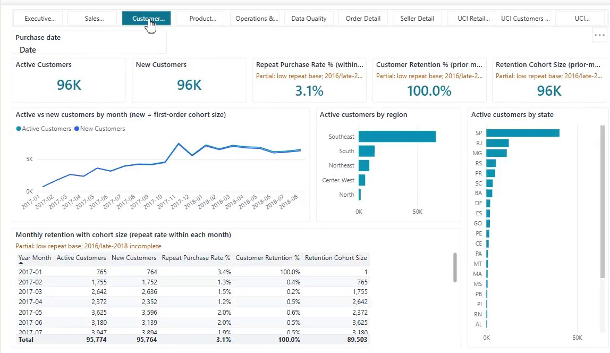</td>
</tr>
<tr>
<td><b>Product Performance</b><br>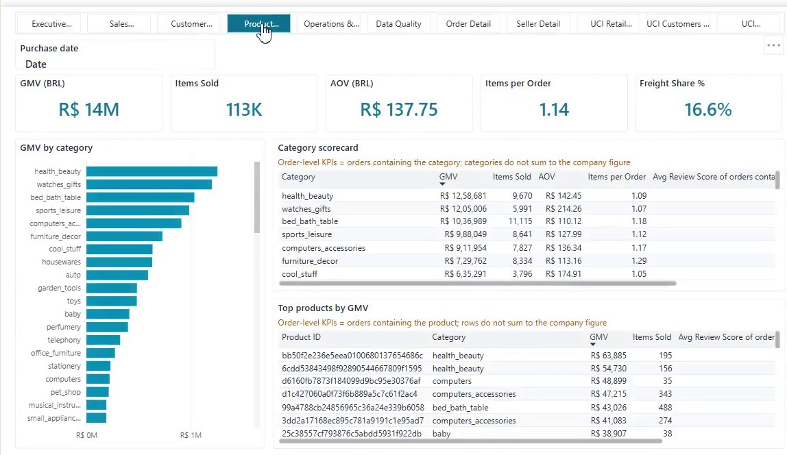</td>
<td><b>Operations & Delivery</b><br>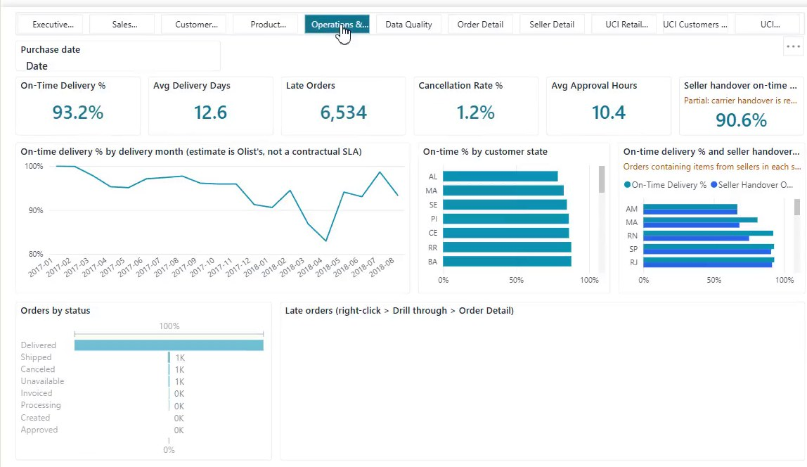</td>
</tr>
<tr>
<td><b>Data Quality</b><br>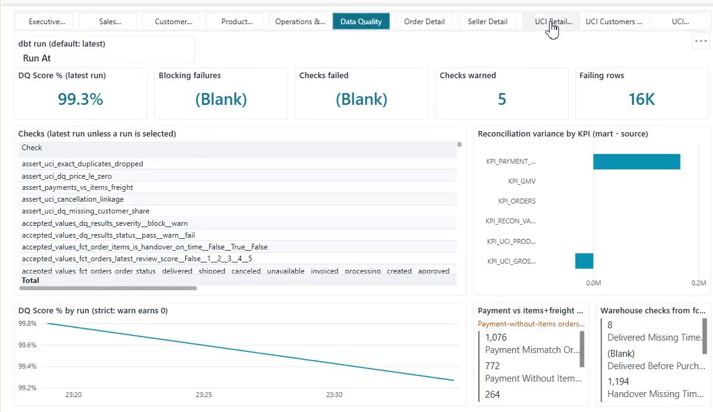</td>
<td><b>UCI Retail Overview</b><br>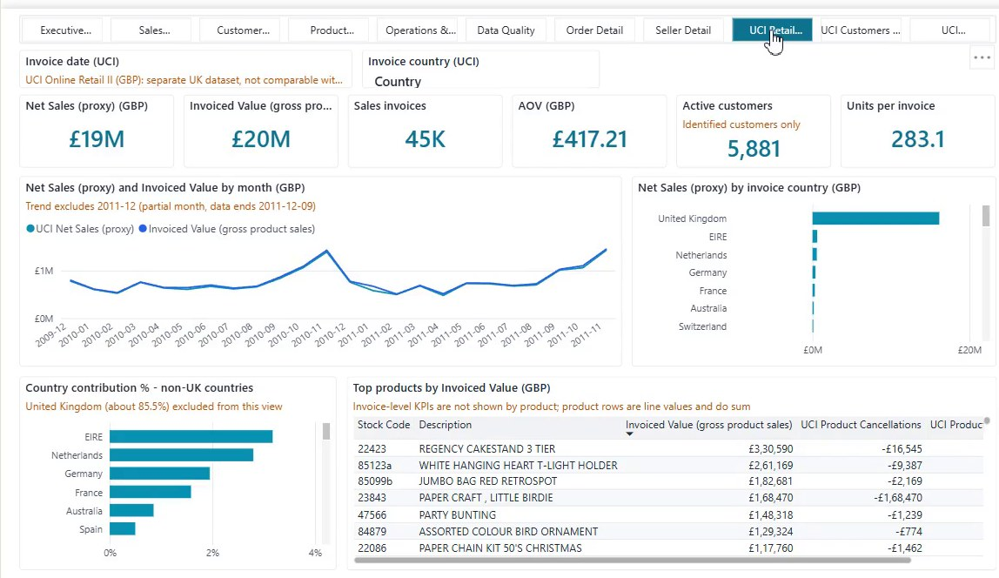</td>
</tr>
<tr>
<td><b>UCI Customers & Retention</b><br>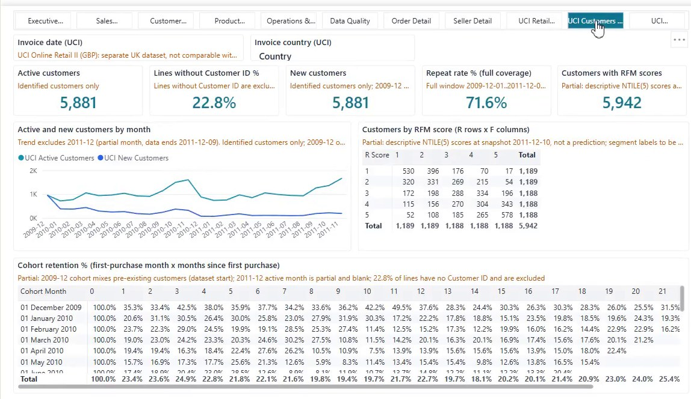</td>
<td><b>UCI Cancellations & Discounts</b><br>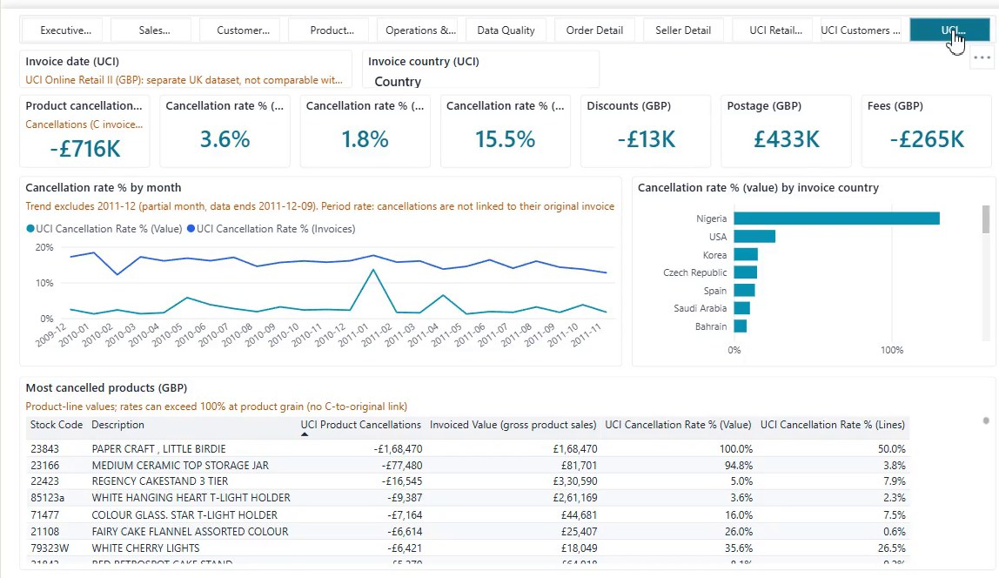</td>
</tr>
</table>

The report also has **Order Detail** and **Seller Detail** drill-through pages (right-click a seller or an order and choose *Drill through*) and tooltip pages. See [`powerbi/README.md`](powerbi/README.md) for how to open and refresh the report.

---

## 📐 KPI Definitions

Every KPI is defined once in [`governance/kpi_dictionary/kpis.yaml`](governance/kpi_dictionary/kpis.yaml), versioned, assigned an owner, and rendered into the [KPI catalog](docs/kpi-catalog.md). A unit test keeps the dictionary in sync.

| KPI | Formula | Power BI measure |
|---|---|---|
| GMV | `SUM(fct_order_items.item_price)` (freight excluded) | `[GMV]` |
| Net GMV | GMV where status not in (`canceled`, `unavailable`) | `[Net GMV]` |
| Orders | `COUNT(DISTINCT order_id)` | `[Orders]` |
| AOV | GMV / distinct orders with items | `[AOV]` |
| On-Time Delivery | on-time eligible orders / eligible orders (delivered ≤ estimated date) | `[On-Time Delivery %]` |
| Avg Review Score | `AVG(review_score)` over the latest review per order | `[Avg Review Score]` |
| Repeat Purchase Rate | customers with ≥ 2 orders / customers | `[Repeat Purchase Rate %]` |
| Cancellation Rate | canceled or unavailable orders / orders | `[Cancellation Rate %]` |
| Seller Handover On-Time | lines where `delivered_carrier_at ≤ shipping_limit_at` / lines with both timestamps | `[Seller Handover On-Time %]` |
| DQ Score | Σ weight of passing checks / Σ weight, latest run | `[DQ Score %]` |

Rules that make these trustworthy:
- **Olist and UCI are never blended**, and BRL and GBP are never summed.
- **Trends use reporting months only.** A month counts when it is complete and not low-volume, which excludes the 2016 ramp-up and the partial tail in late 2018.
- UCI **Net Sales (proxy)** = product sales + cancellations + discounts. Postage and fees are reported separately.

---

## ✅ Data Quality & Testing

| Layer | What is tested |
|---|---|
| **pytest (75 tests)** | Header contracts, BOM handling, SQL ↔ Python row-hash parity, null normalisation, DDL ↔ contract sync, KPI dictionary, live-DB integration (COPY load, idempotent re-run, forced reload, audit) |
| **dbt tests** | `unique`, `not_null`, `relationships`, `accepted_values`, dbt_utils, grain, fan-out, reconciliation (raw → staging → core → marts), month-coverage consistency |
| **Static checks** | `ruff check`, `ruff format --check`, `mypy --strict` |
| **Power BI** | `powerbi/tools/validate_pbip.py` checks the JSON schemas and cross-references |

**Persisted DQ history:** an `on-run-end` hook appends every dbt test result to `dq.dq_results_log`, which is exposed as `core.dq_results` and `core.dq_run_summary`. Each check is weighted (block = 3, warn = 1). The **DQ Score** counts only passing checks, so warnings stay visible on the Data Quality page and are never hidden.

```sql
select dq_score, warned_checks, failed_checks
from core.dq_run_summary
where is_latest_run;
```

The 5 dbt warnings are known, documented data behaviour. For example, about 1.1k Olist orders have payments that legitimately differ from items + freight because of vouchers, instalment interest, or payments without items. See [`docs/assumptions-limitations.md`](docs/assumptions-limitations.md).

---

## 🗂 Project Structure

```
enterprise360/
├── .github/workflows/ci.yml      # lint → type-check → ingest fixtures → dbt build → pytest
├── data/README.md                # dataset provenance, licences, checksums
├── database/ddl/                 # schemas, raw tables, load-audit table
├── ingestion/                    # Python package: contracts, validators, COPY loader, audit
│   ├── sources/                  #   olist.py, uci.py, funnel.py (exact header contracts)
│   ├── loaders/                  #   postgres.py, hashing.py, audit.py
│   └── validators/
├── dbt_enterprise360/            # dbt project
│   ├── models/
│   │   ├── staging/ intermediate/ dimensions/ facts/ marts/ dq/
│   │   └── uci/                  #   staging, intermediate, core, marts
│   ├── seeds/ snapshots/ macros/ tests/
├── orchestration/                # Prefect flow + dbt runner (loads .env)
├── analytics/forecasting/        # GMV/orders forecast + anomaly flags (statsmodels ETS)
├── reporting/                    # export_mis.py → reports/*.xlsx (gitignored)
├── governance/kpi_dictionary/    # kpis.yaml → generated docs/kpi-catalog.md
├── powerbi/                      # Enterprise360.pbip (TMDL model + PBIR report) + tools
├── docs/                         # brief, lineage, source-to-target mapping, KPI catalog
│   └── images/                   # dashboard screenshots
├── scripts/                      # setup.ps1, run.ps1 (Windows)
├── tests/                        # unit/, integration/, fixtures/
├── Makefile                      # Linux/macOS shortcuts
└── pyproject.toml
```

---

## 🚀 Run It Locally

**Prerequisites:** Windows with PowerShell 5.1+, Python 3.12, PostgreSQL 16 (a local service), and Power BI Desktop (January 2026 or later). Download the datasets as described in [`data/README.md`](data/README.md) into `data\raw\olist`, `data\raw\uci_online_retail_ii` and `data\raw\olist_marketing_funnel`.

```powershell
git clone https://github.com/nishanttyagi28/enterprise360.git
cd enterprise360
Copy-Item .env.example .env                 # set POSTGRES_PASSWORD for the e360_app role

.\scripts\setup.ps1 -CreateTestDatabase     # venv, pip install, DDL, dbt deps, dbt debug
.\scripts\run.ps1 -Test                     # ingest Olist + UCI + Funnel → dbt freshness + build → forecast → pytest, ruff, mypy
.\scripts\run.ps1 -Export                   # ... and write reports\enterprise360_mis_YYYYMMDD.xlsx
.\scripts\run.ps1 -Prefect                  # the same pipeline as a Prefect flow
```

Useful options: `-Domain olist|uci|funnel|all`, `-SourceDir <dir>`, `-UciSourceDir <dir>`, `-FunnelSourceDir <dir>`, `-SkipForecast`, `-Export`, `-Force` (reload unchanged files), `-FullRefresh`, and `-CreateDatabase` on `setup.ps1`. If scripts are blocked, run `Set-ExecutionPolicy -Scope CurrentUser RemoteSigned`.

<details>
<summary><b>Linux / macOS (Makefile) and plain <code>python -m</code> entry points</b></summary>

```bash
make setup          # venv + pip install -e ".[dev]"
make ingest         # init-db, then Olist + UCI + Funnel (unchanged files are skipped)
make dbt-build      # dbt deps, source freshness, build
make test lint typecheck
make flow           # Prefect flow
make forecast export
```

```bash
python -m ingestion init-db
python -m ingestion olist [--source-dir DIR] [--force]
python -m ingestion uci   [--source-dir DIR] [--force]
python -m ingestion funnel [--source-dir DIR] [--force]
python -m analytics.forecast [--horizon 3..6] [--no-dbt]
python -m reporting.export_mis [--output PATH]
python -m orchestration.dbt_runner build
python -m orchestration.flow
```
</details>

**Open the dashboard:** open `powerbi/Enterprise360.pbip`. Under *Transform data → Edit parameters*, set `PgServer = localhost:5432`, `PgDatabase = enterprise360` and `PgSchema = core`, then click **Refresh** and sign in with the `e360_app` database credentials. No password is ever stored in the project files.

---

## 🔄 Continuous Integration

GitHub Actions ([`ci.yml`](.github/workflows/ci.yml)) runs on every push and pull request against a disposable `postgres:16` service:

`ruff` → `mypy` → ingest the test fixtures → `dbt deps` + `dbt build` → `pytest` (unit + integration)

---

## 🧠 Design Decisions

- **Text-only raw layer.** Loads never fail on bad values, and casting is done once, in dbt, where it can be tested.
- **Idempotent ingestion.** Each file's sha256 is compared with the last successful load in `raw._load_audit`, so unchanged files are skipped and re-runs never duplicate rows.
- **No fan-out.** Payments are never joined to order lines; both are rolled up to order grain first. Geolocation is collapsed to one median centroid per zip prefix before any join.
- **Incremental facts only where safe.** `fct_order_items` and `fct_payments` use delete+insert on the natural key.
- **SCD Type 2** snapshot of seller location (`snap_olist__sellers`).
- **BI as code.** The Power BI model and report are plain-text TMDL/PBIR, generated by `powerbi/tools/build_pbip.py`, reviewed in Git and validated by script.

More detail: [project brief](docs/00-project-brief.md) · [data lineage](docs/data-lineage.md) · [source-to-target mapping](docs/source-to-target-mapping.md) · [assumptions & limitations](docs/assumptions-limitations.md) · [reporting architecture](docs/blueprint/02-reporting-architecture.md).

---

## 🗺 Roadmap

- [x] Olist ingestion, star schema, marts, DQ logging
- [x] UCI Online Retail II as an independent second domain
- [x] Olist Marketing Funnel (lead cohorts, time to close)
- [x] Monthly GMV/orders forecast with baseline backtest and anomaly flags
- [x] Excel MIS export
- [x] Power BI PBIP report with drill-through and tooltip pages
- [x] CI: lint, type-check, dbt build and tests on fixtures
- [ ] Publish to the Power BI Service with scheduled refresh
- [ ] Set KPI targets and benchmarks with the business owners
- [ ] Host dbt docs (lineage graph) on GitHub Pages

---

## 👤 Author

**Nishant Tyagi** · GitHub [@nishanttyagi28](https://github.com/nishanttyagi28)

If this project is useful to you, a ⭐ is appreciated.

---

## 📄 Licence & Data Attribution

- **Code**: [MIT License](LICENSE), © 2026 Nishant Tyagi. The MIT licence covers the code only; the datasets keep their own licences below.
- **Olist Brazilian E-Commerce** by Olist, [CC BY-NC-SA 4.0](https://creativecommons.org/licenses/by-nc-sa/4.0/). It may be used **for non-commercial purposes only**, and derivatives must be shared alike.
- **Online Retail II** by Daqing Chen, UCI Machine Learning Repository, [CC BY 4.0](https://creativecommons.org/licenses/by/4.0/).
- This repository is a non-commercial portfolio project. Dashboard screenshots contain figures derived from the datasets above.
