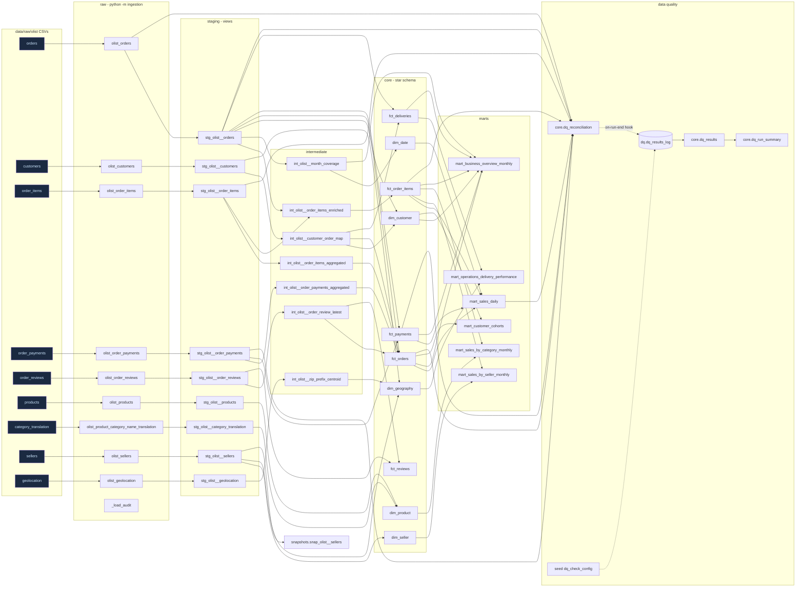
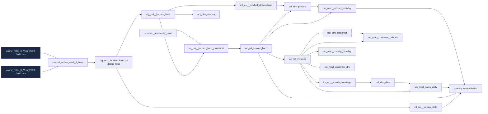

# Data lineage — Olist slice and UCI Online Retail II
Generated from the dbt DAG in `dbt_enterprise360/` (regenerate the interactive version with
`python -m orchestration.dbt_runner docs generate` then `... docs serve`). Power BI reads `core` and `marts`.

Notes
- Payments and order lines meet only at order grain (`int_*_aggregated` → `fct_orders`); never line × payment.
- Raw geolocation reaches the model only through the per-zip-prefix centroid.
- `dq.dq_results_log` is created by the on-run-start hook and appended by on-run-end (every dbt run, incl. warns).

## UCI Online Retail II (independent; no edges to Olist except shared DQ objects)

